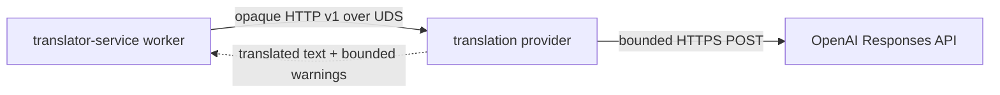

# AELEV Translation Provider

Непрозрачный provider перевода для AELEV. Standalone-модели, весов и
нативного inference runtime в активной поставке больше нет. Provider
вызывает OpenAI Responses API напрямую по HTTPS с системной проверкой TLS.
Текущий выбор в [provider.lock.json](provider.lock.json) — `gpt-6.1-sol`.

Translator передаёт по Unix socket только текст и пару языков.
Provider обогащает запрос provider-owned prompt: модель молча
определяет предметную область всего сегмента и сохраняет
терминологию, регистр, единицы, имена, код и межфразовые связи.
Модель, API, prompt, credential и execution reference не
пересекают opaque-порт.



## Что где искать

- [SPEC.md](SPEC.md) — нормативные границы.
- [USER_MANUAL.md](USER_MANUAL.md) — проверка, секреты, выпуск и откат.
- [contracts/opaque-translation-v1.json](contracts/opaque-translation-v1.json) — неизменный
  приватный контракт.
- [provider.lock.json](provider.lock.json) — API model ID, prompt digest и execution
  profile; для смены модели нужен новый provider release.
- [prompts/domain-preserving-translation-v1.txt](prompts/domain-preserving-translation-v1.txt)
  — закреплённый domain-preserving prompt.
- [TASKS.md](TASKS.md) — открытые integration/admission gates.

## Проверка без API key

```sh
poetry install
poetry run ruff check .
poetry run ruff format --check .
poetry run pyright
poetry run pytest -q
docker build --target test .
docker build --target runtime .
```

Build не запускает container и не требует API key. Для локальной
подготовки замените плейсхолдер в игнорируемом `.env.local`; этот же файл
монтируется read-only как provider credential и не коммитится. После подготовки
runtime-сети действующий OpenAI API key — единственный отсутствующий локальный
ввод для рабочего запуска.
