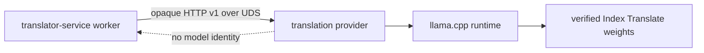

# AELEV Translation Provider

Самостоятельный приватный provider перевода для AELEV. Он владеет способом
получения перевода: моделью, весами, нативным runtime, prompt, cache,
проверкой артефактов и своим выпуском. `translator-service` из
`AELEV-platform-infrastructure` этим не владеет и не знает, что находится за
непрозрачным портом.

Provider принимает через Unix socket только текст и пару языков и возвращает
только перевод с ограниченными предупреждениями. Kafka, очередь, задания,
идемпотентность, operator API и сохранённые результаты остаются в Translator.



## Что где искать

- [INDEX.md](INDEX.md) — агентская карта репозитория.
- [SPEC.md](SPEC.md) — нормативные границы и инварианты.
- [USER_MANUAL.md](USER_MANUAL.md) — сборка, выпуск, эксплуатация и откат.
- [architecture.mmd](architecture.mmd) — исходник архитектурной диаграммы.
- [contracts/opaque-translation-v1.json](contracts/opaque-translation-v1.json) —
  машинно-читаемый приватный контракт.
- [provider.lock.json](provider.lock.json) — точные веса и runtime profile.
- [docs/adr/INDEX.md](docs/adr/INDEX.md) — ключевые решения продукта.
- [PROVENANCE.md](PROVENANCE.md) — сохранённая история выделения.

## Проверка без загрузки модели

```sh
poetry install
poetry run ruff check .
poetry run ruff format --check .
poetry run pyright
poetry run pytest -q
docker build --target test .
```

Полный runtime image содержит проверенные веса и потому собирается только
release pipeline. Рабочее развёртывание использует исключительно точный
`ghcr.io/sapogov1978/aelev-translation-provider@sha256:...`, а не mutable tag.

Официальные документы поставщиков собраны в
[docs/references/official-sources.md](docs/references/official-sources.md).
