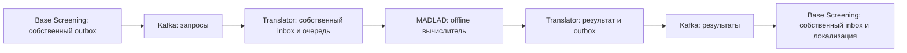

# Историческая рабочая проверка выделения translator-service, 7 октября 2026

Это историческая проверка локального развёртывания и сохранности данных, а не новый допуск качества MADLAD или production-сертификация. Актуальная нормативная граница находится в [SPEC](../SPEC.md), публичные события — в [Kafka-контракте](../../../../docs/api/translation.md).

## Граница и переключение

MADLAD, его Rust-исходники, зависимости, веса, очередь и управление перенесены в собственный сервис. Base-screening сохраняет только заказ перевода, накопленную локализацию и переводы карточек. Между владельцами работают `TranslationRequested` и `TranslationCompleted`; Unix socket доступен исключительно двум внутренним ролям translator-service. Внутренний вычислитель не имеет сети. Прежний контейнер переводчика остановлен и сохранён для отката; прежние данные и тома не удалены.



С отдельного разрешения оператора общий инфраструктурный PostgreSQL подключён к внутренней сети `aelev-translator-data`. Новая роль `translator_service` не имеет `SUPERUSER`, `CREATEDB` и `CREATEROLE`; проверка `CONNECT` к `crawler` и `zone_ingestion` вернула `false`. Миграция собственной БД — `20261007_0001`. Пароль находится только в игнорируемой конфигурации с правами `0600` и в этом документе не приводится. Из-за исчерпания стандартного Docker address pool новая сеть получила отдельный проверенный subnet `10.253.13.0/24`; чужие сети не пересоздавались.

Окончательное обновление только исходников — `aelev/translator-service:kafka-v3`, digest `sha256:bed33d329b1f1dca19799fb496080fec05410e31fa80290b28fb0e5007fb77a7`. Все четыре постоянные роли используют этот образ и `restart: unless-stopped`; вычислитель подтвердил healthy после загрузки модели. Собственная пауза и продолжение дали ревизии 2 и 3, очередь снова RUNNING. Проверка собственной БД после обновления вернула `{"status":"VERIFIED","jobs":6}`; карантин пуст. Готовые результаты не переочередялись командой обновления.

## Сохранённые данные владельца

При исходном измерении и после первичного переключения сохранены 297 готовых локализаций, 304 готовых переводов операторских карточек и 251 ревизия человеческих решений. SHA-256 отсортированных ссылок готовой локализации не изменился:

```text
9cf9e5b170d18e62934901201b85294de07d4ce5344b7fa9317525c84df171e9
```

Готовые данные не сбрасывались и не переводились повторно. Исторические FAILED/RETRY не выданы за новые успешные переводы. Действующий экспериментальный выпуск классификаторов и критерии политики не менялись; `.com` и `.org` не включались.

## Реальный запрос и повтор

Контрольная фраза прошла полный путь через рабочие outbox, Kafka, новую очередь, реальный MADLAD и inbox заказчика. Для диагностического запроса не создавалась человеческая метка или искусственная операторская карточка.

```json
{
  "operation": "PROFILE_UNIT",
  "request_id": "ef15f37e-090c-5af4-801c-40f68ac25fac",
  "result_id": "2af2928c-c2a5-55dc-86ed-2abe1872c193",
  "source_language": "en",
  "target_language": "de",
  "text": "central bank",
  "translated_text": "Zentralbank von Deutschland",
  "attempt_count": 1,
  "client_wall_seconds": 197.551,
  "worker_wall_milliseconds": 99478,
  "repeat_client_wall_seconds": 0.212,
  "localization_ref": "sha256:0235c582987bc530c78a81dceec5232161a7b058999c283d903076cc75f4a516"
}
```

Время первого клиента включает очередь; время работника — внутренний вызов, в том числе загрузку перезапущенного вычислителя. Повтор вернул прежний `localization_ref`, число вычислительных попыток осталось равным одному. Это подтверждает транспорт и повтор сохранённого ответа, но не скорость чистого тёплого inference. Добавление «Германии» отсутствует в оригинале и является семантической ошибкой; результат не объявляется качественно проверенной локализацией политики.

## Незавершённые реальные переводы

Длинные задания обнаружили сохранённую проблему runtime: timeout отдельного сегмента 180 секунд, после которого задание автоматически повторяется. Очередь не получает CANCELLED. Исходные тексты карточек не копируются в этот отчёт; приведены только идентификаторы и метаданные.

```json
{
  "observed_jobs": [
    {"request_id": "a25195c2-6170-583a-8931-01bad47c2047", "operation": "OPERATOR_REVIEW", "source_language": "ko", "target_language": "en", "original_characters": 3025, "representative_excerpt_limit": 768, "observed_timed_out_attempts": 2},
    {"request_id": "8799c72d-4702-58d5-97f0-0c78950fd4c9", "operation": "PROFILE_UNIT", "source_language": "en", "target_language": "yo", "characters": 131, "observed_timed_out_attempts": 1},
    {"request_id": "bc0624e2-de3f-5b40-9069-b830d7759941", "operation": "OPERATOR_REVIEW", "source_language": "uk", "target_language": "en", "original_characters": 2298, "observed_timed_out_attempts": 1},
    {"request_id": "dd9795fb-6c58-5a6b-9807-b5a48b6fe4fb", "operation": "OPERATOR_REVIEW", "source_language": "ru", "target_language": "en", "text": "Банк повысил ключевую ставку.", "client_wait_seconds_limit": 300, "client_result": "TRANSLATOR_UNAVAILABLE", "request_preserved": true}
  ]
}
```

Ожидание клиента не является отменой вычислительного задания. После timeout запрос остаётся у владельца и в собственной очереди переводчика; повтор использует тот же идентификатор. Готовые единицы сохраняются независимо от последующих ошибок других языков. Политика локализуется по одной фразе, не полным словарём; для длинного операторского оригинала сохраняется прежний ограниченный рецепт с явным предупреждением, а не незаметное изменение входа обучения.

Исправлены два обнаруженных дефекта: после timeout порядок теперь использует `available_at`, чтобы повтор не вытеснял уже ожидающие задания; health становится готовым только после точного сигнала загрузки дочернего runtime, не по факту существования процесса. Дополнительно проверено, что Kafka-локализация норвежского не зависит от приватного токена MADLAD и сохраняет checkpoint владельца.

После продолжения первоначальный короткий операторский запрос завершился автоматически с прежним идентификатором. Не создавались новый запрос, карточка или человеческая метка. Результат прочитан клиентом владельца и затем повторно получен без вычисления:

```json
{
  "operation": "OPERATOR_REVIEW",
  "request_id": "dd9795fb-6c58-5a6b-9807-b5a48b6fe4fb",
  "result_id": "503e0ac5-e874-5706-8421-e03b0755604d",
  "request_recorded_at": "2026-10-07T12:57:19.026754+00:00",
  "result_recorded_at": "2026-10-07T13:15:57.518419+00:00",
  "source_language": "ru",
  "target_language": "en",
  "text": "Банк повысил ключевую ставку.",
  "translated_text": "The bank raised the key rate.",
  "status": "SUCCEEDED",
  "attempt_count": 1,
  "worker_wall_milliseconds": 61082,
  "completed_result_client_wall_seconds": 0.571,
  "repeat_client_wall_seconds": 0.067,
  "warnings": ["MACHINE_TRANSLATION_UNVERIFIED"],
  "translation_ref": "sha256:5a00692e8b9ea50d7f97b6508775014bf66224784111fb6706b5c9fa517d1978",
  "request_digest": "sha256:7ed8a4bd141d8ddfd68a6ebb8a3407778023c47e38ba188199d514b0f047dbe6"
}
```

Полная задержка этого запроса — около 18 минут 38 секунд, включая ожидание чужих активных заданий и эксплуатационную паузу обновления. Короткое чтение уже готового результата не выдаётся за такую же скорость перевода. Подтверждён именно путь восстановления после первоначального клиентского timeout и чтение результата, а не приемлемая пропускная способность длинных переводов.

## Проверки и ограничения

Самостоятельная полная сборка из каталога сервиса завершена с прежними закреплёнными Python/Bookworm/Rust/Poetry и модельными артефактами. Cargo lock, Rust-исходник и модельный lock совпадают с прежними; новый модельный выпуск не выбирался. Обновления только исходников используют образ этого же самостоятельно собранного сервиса, не образ base-screening.

Пройдены 24 проверки translator-service на изолированной PostgreSQL, Ruff, проверка форматирования и строгий Pyright. Проверены идентичный повтор, коллизия идентификатора, просроченный lease, PAUSE/RESUME/RESET, отсутствие Kafka commit при SQL-сбое, устойчивый outbox, восстановление и процессный deadline. Инфраструктурные проверки — 87 успешных тестов сетей, изолированного provisioning, хранения Kafka и политик перезапуска. Base-screening прошёл 26 целевых проверок логического клиента, накопления локализации и Kafka-проекции. Публичные схемы и самостоятельный экспорт провалидированы.

Отдельное восстановление снимка собственной БД в изолированный тестовый экземпляр прошло `verify-restored-state` с `VERIFIED`; это не измерение RPO/RTO двух независимых failure domain. Таймауты длинных переводов, семантическое качество, полная наблюдаемость и защищённая production-поставка остаются отдельными незавершёнными воротами [TASKS](../TASKS.md). Статус сервиса остаётся `IN_PROGRESS`; выделение процесса и работа транспорта не превращают эти ворота в завершённые.
